# Talking Tokens (Foundry VTT v11 and later)

Talking Tokens shows a speech bubble on a token while its player speaks in Discord voice.

A small program, the **bridge**, runs on the GM computer. The bridge logs in a Discord bot that follows the GM into
voice. The bot sees only *who* speaks. It does not record, decode, or store any audio.

Only the GM does the setup. Players install nothing.

- [Setup](#setup) (one time, about 10 minutes)
- [Each game session](#each-game-session)
- [Troubleshooting](#troubleshooting)
- [Privacy](#privacy)

## Setup

Do all steps on the computer that runs Foundry (the GM computer).

### Part 1: Create the Discord bot

Each GM makes their own bot. Discord has no other way to do this.

1. Open the [Discord Developer Portal](https://discord.com/developers/applications) and log in with your Discord
   account. Click **New Application**.

   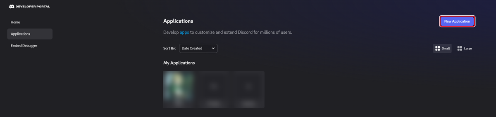

2. Type a name, for example `Talking Tokens`. Tick the box to accept the terms. Click **Create**.

   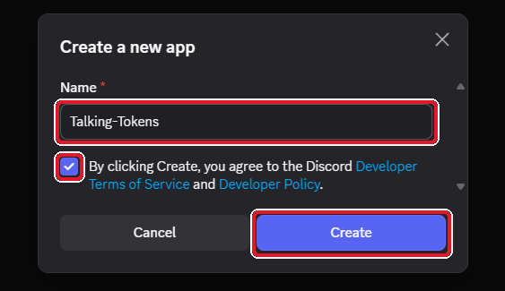

3. In the left menu, click **Bot**.

   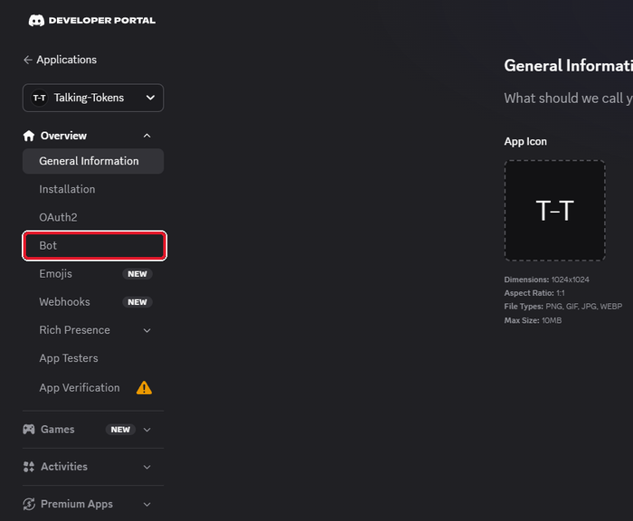

4. Click **Reset Token**.

   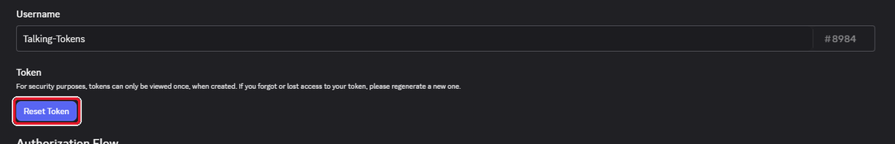

5. Click **Yes, do it!**. If Discord asks for your two-factor code or your password, type it.

   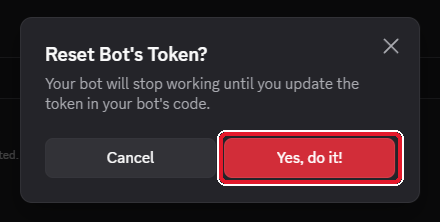

6. Click **Copy**. The bot token is now on your clipboard. Keep this browser tab open until step 13.

   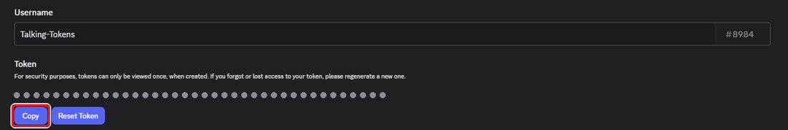

> **Keep the token secret.** A person with the token controls your bot. If you show the token to someone by
> mistake, do steps 4 to 6 again. The old token then stops working.

### Part 2: Start the bridge

7. Download [talking-tokens-bridge.exe](https://github.com/b1o/foundry-vtt-talking-tokens/releases/latest/download/talking-tokens-bridge.exe).
   Put it in a folder that you can find again, for example your Desktop.

8. Double-click `talking-tokens-bridge.exe`. Windows can show "Windows protected your PC", because the program has no
   paid signature. Click **More info**.

   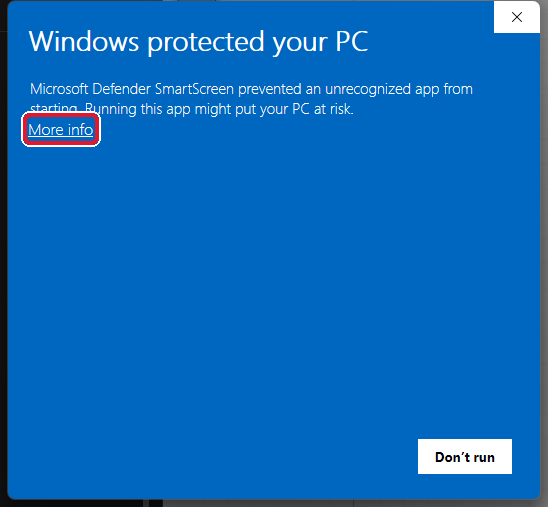

9. Click **Run anyway**. Windows asks this only the first time.

   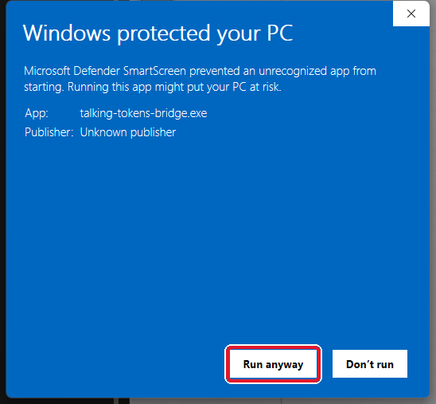

10. A black window opens. It shows lines like these:

    ```
    Talking Tokens bridge 0.1.0
    Config: C:\Users\<you>\AppData\Roaming\talking-tokens-bridge\config.json
    Waiting for setup. Open the Talking Tokens panel in Foundry and paste your bot token.
    Foundry can connect on ws://127.0.0.1:37521
    ```

    Keep this window open while you play. To stop the bridge, close the window.

### Part 3: Install the module and open the panel

11. In the Foundry setup screen, click **Add-on Modules → Install Module**. Paste this manifest URL and click
    **Install**:

    ```
    https://github.com/b1o/foundry-vtt-talking-tokens/releases/latest/download/module.json
    ```

    Then start your world, and enable **Talking Tokens** in **Game Settings → Manage Modules**.

12. Open Foundry on the GM computer through the Foundry desktop app, or in a browser at `http://localhost:30000`.
    Use `localhost`, not an IP address or a domain name. Log in as the GM. Click the **Token Controls** (the person
    icon), then the **Talking Tokens** button (the speech bubble).

    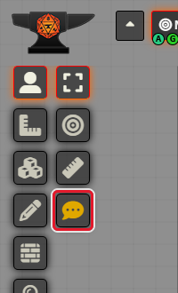

    The panel opens and finds the bridge by itself. If it shows "The Talking Tokens bridge is not running", go back
    to step 8.

### Part 4: Connect the bot

13. Under **Bot setup**, click the token field and paste the token (Ctrl+V). Click **Save token**.

    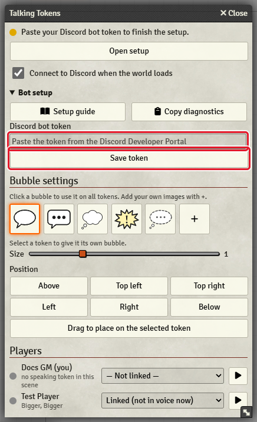

    The bridge keeps the token on this computer. Foundry does not store it.

14. The panel shows "The bot is in no Discord server". Click **Invite the bot to a server**. Your browser opens
    Discord.

    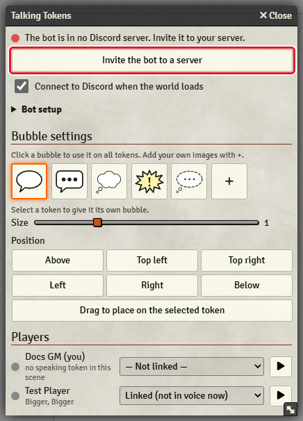

15. Select your Discord server and click **Continue**. Only servers where you have the **Manage Server** permission
    show in the list (the server owner always has it).

    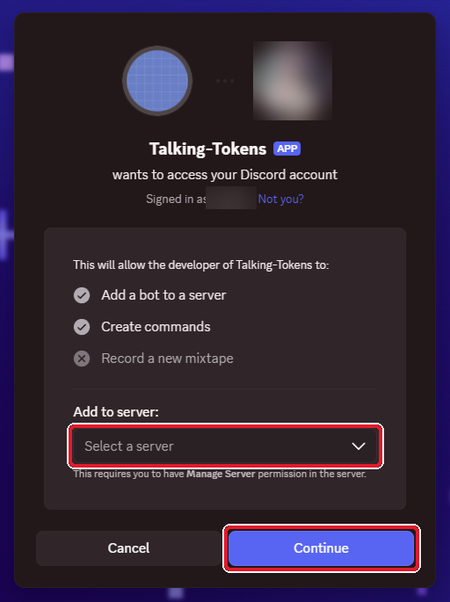

16. Click **Authorize**. The bot asks only for "View Channels" and "Connect".

    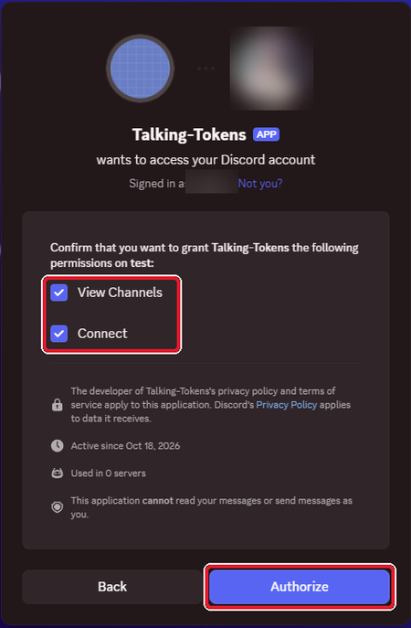

17. In the Discord app, join a voice channel.

18. In the panel, under **Who are you?**, click your own Discord name.

    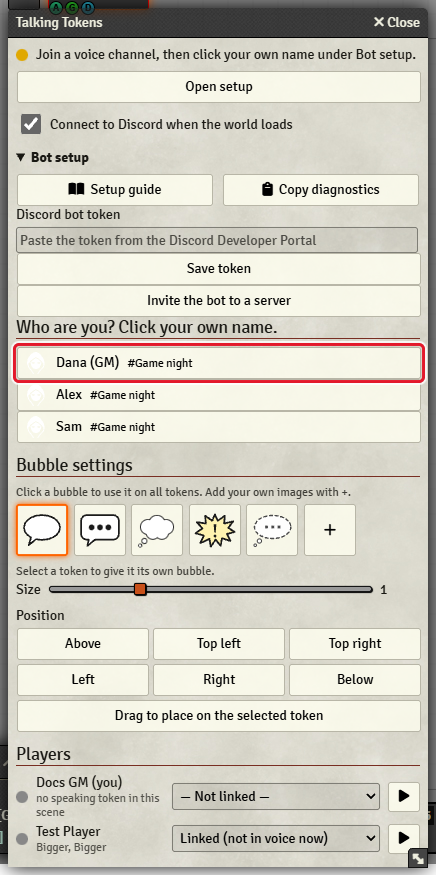

19. The bot joins your voice channel. The panel shows "Listening in #your-channel" with a green dot.

    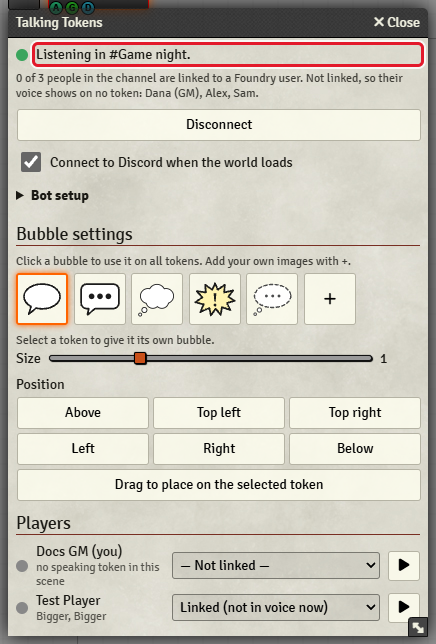

### Part 5: Link the players

20. Ask your players to join your voice channel. Under **Players**, select the Discord name of each Foundry player.

    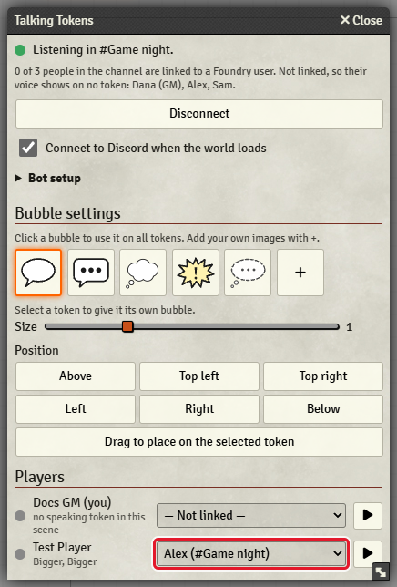

    The link stays in the world. You do this only once for each player.

### Part 6: Choose the speaking token

By default, a player's voice shows on the token of their assigned character (**User Configuration → Character**).
The small text under each player name in the panel shows the token that speaks now.

21. To use a different token, for example a companion: right-click the token and click the **microphone** in the
    Token HUD. Players can do this for their own tokens. Click the microphone again to go back to the assigned
    character.

    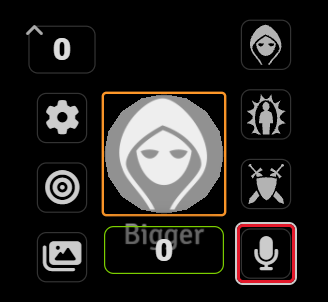

    Faster: point at the token and press **M**. Change the key in **Game Settings → Configure Controls → Talking
    Tokens**.

22. The GM has no assigned character. To show your own voice, mark an NPC token with the microphone in the same way.

23. To check a token without speaking, click the **▶** button next to a name under **Players**. The bubble shows on
    that user's speaking token for 3 seconds, for every user.

The setup is complete.

## Change the bubble

Open the panel. All settings under **Bubble settings** apply to every user at once.

- Click a bubble to use it on all tokens. The bubble in use has an orange frame.
- Click **+** to add your own image (PNG, WebP, or SVG with a transparent background works best). Click the small
  **×** on an image to remove it from the list.
- To give one token its own bubble, select the token on the map. Then pick a bubble in **Bubble of** (followed by the token name). Pick
  "The bubble for all tokens" to undo this.
- Drag the **Size** slider. Visible bubbles change size while you drag.
- Click a **Position** button, or select a token and click **Drag to place on the selected token**. Drag the bubble,
  then click **Save position**.

## Each game session

1. Double-click `talking-tokens-bridge.exe`.
2. Open your world in Foundry through `localhost` or the desktop app.
3. Join a voice channel in Discord.

The panel connects by itself. The color of the **Talking Tokens** button shows the state: green when the bot
listens, yellow while it waits (for example for you to join voice), and red when it is not connected or has a
problem. Hold the pointer on the button to read the status.

The bot follows you when you change the voice channel, and it leaves when you leave voice.

## Troubleshooting

The status line at the top of the panel always shows one message. Find the message below.

| The panel says | What to do |
|---|---|
| "Open Foundry on this computer through localhost …" | Open Foundry on the GM computer through the desktop app or `http://localhost:30000`. A browser blocks the connection to the bridge from any other address. |
| "Looking for the Talking Tokens bridge…" | Wait a few seconds. If the message stays, reload Foundry (F5). |
| "The Talking Tokens bridge is not running on this computer." | Double-click `talking-tokens-bridge.exe` (step 8). The panel connects by itself. If the black window closes at once, see [The bridge window closes](#the-bridge-window-closes). |
| "The bridge is version … This module needs the bridge of version …" | Download the [newest bridge](https://github.com/b1o/foundry-vtt-talking-tokens/releases/latest/download/talking-tokens-bridge.exe), close the old bridge window, and start the new file. Also update the module in the Foundry setup screen. |
| "Paste your Discord bot token to finish the setup." | Do steps 1 to 6 and step 13. |
| "Not connected to Discord." | Click **Connect**. To connect each time the world loads, tick **Connect to Discord when the world loads**. |
| "Logging in to Discord…" | Wait. If this stays for more than a minute, close the bridge window and start the bridge again. |
| "Discord rejected the bot token." | The token is wrong or old. Do steps 4 to 6 again, then step 13. |
| "Discord cannot be reached." | Check the internet connection of the GM computer. Then click **Connect**. |
| "The bot is in no Discord server." | Do steps 14 to 16. |
| "Join a voice channel, then click your own name under Bot setup." | Do steps 17 and 18. |
| "Waiting for you to join a voice channel." | Join a voice channel in Discord. The bot follows you. |
| "The bot cannot join #channel." | In Discord, open the channel settings → **Permissions**. Give the bot (or its role) **View Channel** and **Connect**. The bot then joins by itself. A full channel (user limit) also stops the bot. |
| "Joining #channel…" | Wait a few seconds. If this stays, click **Disconnect**, then **Connect**. |
| "The connection to Discord dropped. Reconnecting…" | Wait. The bridge reconnects by itself. If this stays, check the internet connection of the GM computer. |
| "Listening in #channel." | All is well. The line below it counts the linked people and names the people who are not linked; link them under **Players**. If a bubble does not show, see below. |

### A bubble does not show

- Check that the player is linked under **Players** (step 20).
- Check the small text under the player name. "no speaking token in this scene" means: the player has no assigned
  character on this scene, and no token with the microphone mark. Do step 21.
- A player does not see a bubble on a token that they cannot see (for example a hidden token).
- Each user can turn the bubbles off for themselves in **Game Settings → Configure Settings → Talking Tokens → Show
  speech bubbles**. Check that it is on.

### The bridge window closes

- If another bridge already runs, the new window closes at once. This is correct: the first bridge stays.
- If the bridge stops because of an error, it writes the error to
  `%APPDATA%\talking-tokens-bridge\bridge.log`. Send this file with your bug report.

### Report a bug

Open the panel, open **Bot setup**, and click **Copy diagnostics**. Paste the text into your bug report on
[GitHub](https://github.com/b1o/foundry-vtt-talking-tokens/issues). The text has versions and states only: no token
and no names.

## Privacy

- The bot only reads which person sends voice packets. It does not decode, record, store, or forward audio. Tell
  your players this, because they see the bot in the voice channel.
- The bridge accepts connections only from this computer (`127.0.0.1`), and only from a Foundry page that is open
  through `localhost`.
- The bot token stays in `%APPDATA%\talking-tokens-bridge\config.json` on the GM computer. It goes to the bridge
  once, from the panel, and never back to Foundry. Foundry stores only the link between a Foundry user and a Discord
  user id.
